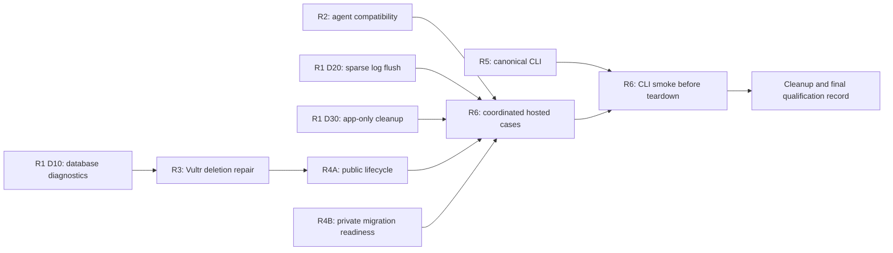

# Database release repairs — execution plan

Status: integration and repair code written; local and hosted validation deferred. Date: 2026-11-10.

## Current code status

Upstream public `main` (`05547e5`) is contained in local `main`; the preserved local application/environment work was reconciled with its database changes. Private operations `main` was fast-forwarded to `7c6d1be`. The original local backup stash remains retained. No release, deployment or publication was performed for this repair pass.

| Repair | Code outcome | Still requires validation |
| --- | --- | --- |
| R1 | Safe database failure classifications, sparse deployment-log flushing and retained operator-helper corrections. | Focused regressions and operator-helper cases have not run. |
| R2 | Inspected canonical runtime routes and ownership guards; no demonstrated compatibility defect justifies changing them. Helper error-code extraction is corrected to expose the actual rejection. | Historical HTTP 400 cause and eligible-agent upgrades remain unconfirmed. |
| R3 | Bounded PostgreSQL readiness after access-container recreation; access rollback retains sanitized failing-stage/type evidence. No provider-specific workaround or mutation retry. | Historical Vultr failure cause and owned fixture deletion remain unconfirmed. |
| R4 | Failed create/delete lifecycle transitions and exact-candidate API readiness before strict migration inventory comparison. | New regression source and local integration cases have not run. |
| R5 | Removed the Intel Mac build/asset dependency; aligned release counts, installer behavior and supported-target documentation. | Packaged checks, publication and clean installation remain pending; no branch rules were changed. |
| R6 | Existing acceptance paths and retained private helpers remain the qualification surface. | Backup rows, access/network, explicit migration, CLI smoke and cleanup are deferred to the testing/deployment stages. |

The current instruction is code completion first. Regression source is written with each repair, but tests, builds and hosted cases must remain a separate subsequent stage. Code inspection and merge resolution do not establish that these repairs pass. Unknown historical causes stay open until reproduced; do not equate the readiness fixes with proof of those causes.

## Goal and boundary

Close the six unfinished areas from database release `05547e5`: diagnostics/cleanup, agent compatibility, blocked Vultr deletion, lifecycle/readiness, matching CLI delivery, and hosted acceptance. The API/worker/dashboard release and its basic data checks passed; full database qualification and the follow-ups below did not.

This package bounds repairs to existing functionality. The code status above records implementation separately from validation and does not authorize live changes. Removing all prebuilt CLI distribution and improving self-hosted installation remain the separate projects in the [pre-v1 backlog](../../pre-v1-release-backlog.md).

No new feature scope, orchestration framework, recovery API, logging platform, provider, compatibility shim by assumption, cluster, replication, PITR, or failover. Unknown causes must be reproduced before a code fix is chosen. Use existing utilities, operation contracts, logging, tests, and normal APIs.

## Specs and implementation order

| ID | Specification | Start / hard dependency |
| --- | --- | --- |
| R1 | [Diagnostics and application-only cleanup](01-diagnostics-and-cleanup.md) | D10 starts first for unknown database failures; D20 and D30 are independently bounded. |
| R2 | [Existing-agent compatibility](02-agent-compatibility.md) | Can start immediately, in parallel with R1. Capture the actual 400/guard evidence before a product fix. |
| R3 | [Blocked Vultr deletion](03-vultr-deletion.md) | D10 merged and failing substep identified. Finish its shared-file edits before R4A. |
| R4 | [Lifecycle and migration readiness](04-lifecycle-readiness.md) | Public task 04A follows D10 and R3; private task 04B can investigate immediately and fix only after reproduction. |
| R5 | [Matching canonical CLI](05-canonical-cli.md) | Can start immediately, independently of the worker repairs. Intel Mac is not a release gate. |
| R6 | [Hosted acceptance](06-hosted-acceptance.md) | Prepare cases in parallel. Live cases wait for relevant repaired boundaries; CLI case additionally waits for R5. |

The numbered filenames identify work; they do not require six serial projects. R3's local implementation precedes R4A, while its owned hosted-cleanup proof can be coordinated with R6. This is not a circular dependency: repair the old fixture before allocating a fresh qualification set.

## Three parallel implementation lanes

Use one integration owner plus up to three implementation agents. The integration owner sequences merges, holds the write-ownership map, and coordinates live work; no additional team/orchestration runtime is required.

| Lane | Sequence | Exclusive write boundaries |
| --- | --- | --- |
| A — database worker | R1 D10 → R3 → R4A; D30 when the helper is retained | `DatabaseOperationProcessor.cs`, implicated database access/runtime files, and the corresponding database worker tests. Hand off the processor failure block between these patches; do not edit it concurrently. |
| B — runtime and operations | R2 + R1 D20 → R4B | Agent/deployment controller and runtime-agent files; `SshDeployStep.cs`/`DeploymentLogWriter.cs` for D20; later private maintenance helper, private remote-deploy script, and their tests. D20 belongs to this same lane to avoid competing edits with R2. |
| C — client and qualification preparation | R5 → R6 local/offline preparation | CLI/release/installer files and CLI tests; then acceptance cases and assertions. No paid allocation or hosted writes during preparation. |

Public product ownership is in `minicloud/`. Hosted deployment/recovery scripts belong in private `minicloud-services/`; retained private product modules are historical and must not receive these product fixes. Paths and line references in the specs describe the current source and must be rechecked when work begins.

If a reproduced cause crosses a listed boundary, request a file handoff from the integration owner. Do not refactor or split modules merely to manufacture parallelism. Read-only investigation may overlap; two agents must not write the same file or change the same hosted resource concurrently.

## Integration and verification gates

1. **Refresh evidence, no mutations.** Confirm current source/working-tree state and refresh the historical failure/resource inventory. The old temporary credentials were revoked. Obtain properly scoped current authorization; keep identities and secrets out of committed files. A released fix is not a remaining repair: preserve the current-attempt readiness marker and temporary operation-staging fixes already in `05547e5`.
2. **Small local repairs.** Each owner writes a regression for its reproduced failure, changes only the implicated boundary, runs affected checks, and hands off a reviewable patch. R1 D10 merges before R3/R4A touch the common failure path. R2 and R5 may merge independently once their own checks pass.
3. **Candidate integration.** Integrate completed repair patches into one reviewed candidate. Verify focused worker/API/CLI/runtime tests appropriate to those changes. Preserve authorization, leases, data/backup retention, existing healthy data, and all strict migration comparisons. Source or local-test success is not hosted qualification.
4. **Retained cleanup first.** Deploy the reviewed repair through the existing supported operations path when separately authorized. Reconcile the owned blocked Vultr fixture, then confirm provider-resource absence before fresh paid allocation. Never adopt historical IDs without current ownership proof.
5. **Hosted cases.** Start R6 API/database cases after relevant R1–R4 checks pass; do not hold those cases for unrelated CLI packaging. Perform the R5 client smoke against the same fixture set once delivery is ready, before teardown. One operator controls hosted mutations and records bounded progress. Parallelize offline verification, not mutations to a shared consumer or access policy.
6. **Close out.** Observe terminal asynchronous cleanup, confirm owned provider resources absent, revoke temporary credentials, and record passes/blocked cases. Keep raw logs/state under each owning repo's ignored `.local/artifacts/`; maintain only a concise sanitized result summary in source control.

## Definition of done and stop rules

- Each known failure has a reproduced cause and passing focused regression, or remains explicitly open with the missing evidence named. Do not claim a repair from a guessed explanation.
- Eligible agents and the matching delivered CLI use the canonical API, without bypassing lifecycle/ownership guards or requiring an Intel Mac build.
- Database/server states reflect terminal outcomes; the retained Vultr database/server and qualification fixtures are actually removed through supported paths.
- Readiness gates delay admission until the exact candidate migration has completed, then enforce the original exact inventory comparison.
- R6 records actual backup, restore-data, network/access and explicit-migration outcomes; completed operation status or table counts alone do not prove recovered data.
- No unrelated application was redeployed, altered or deleted, and no temporary key or paid fixture is left unaccounted for.

If a step requires another API/subsystem, an unplanned resource, relaxed safety checks, or a repair outside these six areas, stop that branch and record it separately. Do not silently implement it. A blocked or deliberately deferred criterion stays open; it is not converted into a pass to finish the plan.
