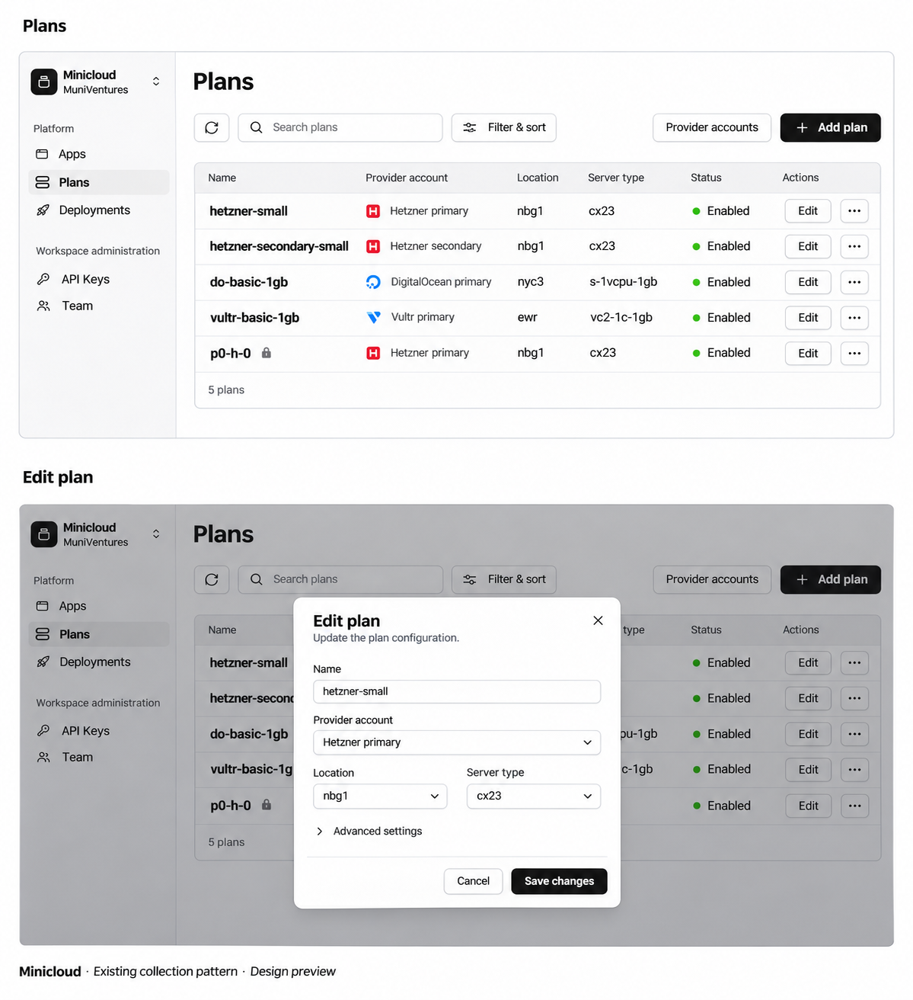

# Plan-first provider management UX

Status: Implemented locally in dashboard; hosted deployment verification is separate.
Date: 2026-11-09.

## Outcome and approved direction

Replace the account-first Providers page with a plan-first collection. A user
should find and maintain named deployment plans using the same collection and
form interactions already used elsewhere in Minicloud. Provider accounts remain
available as secondary configuration.

The approved pattern is a shared refresh/search/Filter & sort toolbar, a standard
Card/table, explicit Edit buttons, overflow menus and centered add/edit dialogs.
There is no permanent details panel, Accounts/Plans tab switcher or account card
containing another collection. This specification does not authorize implementation.

The image establishes hierarchy and styling, not live account data or new API
capabilities. The constraints below govern account selection, placement locking
and catalog inputs even where the illustration shows generic dropdowns.

## Scope and existing contracts

- Keep organization-owned accounts and organization-wide unique plan names.
- Each plan resolves exactly one account. Multiple accounts of the same provider
  remain independent; there is no quota fallback or automatic account selection.
- CLI and `minicloud.yml` still reference the plan name only.
- Preserve stable plan IDs, retired-name protection, revision checks, resource
  bindings, credential custody and backend mutation rules.
- This is dashboard UX work. No API/schema migration, provisioning, billing,
  account reassignment, credential-readback or deployment behavior is added.
- Do not add CPU/RAM, prices, quotas, usage counts or live catalogs without data
  already exposed by the existing contracts.

The domain source of truth remains
[Provider accounts and named plans](provider-accounts-and-plans.md). The shared
design contract is [DESIGN.md](../../DESIGN.md).

## Evidence and component reuse

Paths are relative to the product repository:

| Existing surface | Pattern to reuse |
| --- | --- |
| `modules/dashboard/app/core/components/PageScaffold.tsx` | Page title, breadcrumbs, shell spacing. |
| `modules/dashboard/app/core/components/CollectionToolbar.tsx` | Refresh, search, Filter & sort popover, one primary and one outlined secondary action. |
| `modules/dashboard/app/core/components/collectionQuery.ts` | Organization-scoped session query state and stable sorting. |
| `modules/dashboard/app/modules/ApiKeys/ApiKeysModule.tsx` | Card/table collection, on-demand modal form, destructive confirmation and focus restoration. |
| `modules/dashboard/app/modules/Settings/TeamSettingsModule.tsx` | Plain informational table rows and responsive labeled cells. |
| `modules/dashboard/app/modules/Apps/AppsModule.tsx` | Collection loading, error and no-match states. Its Cards/List option is not required for Plans. |
| `modules/dashboard/app/modules/Providers/ProvidersModule.tsx` | Existing account/plan mutation and form semantics to preserve. |
| `modules/dashboard/app/api/providersApi.ts` | Existing data and mutation contract; reuse its request helpers. |

Do not change the shared collection behavior for other modules as part of this
feature. Plain rows do not navigate or open editors; actions are explicit.

## Navigation

| Destination | Route and behavior |
| --- | --- |
| Plans | `/plans`; replace the current Providers sidebar label with Plans, preserving the existing sidebar placement/icon treatment. |
| Provider accounts | `/plans/accounts`; accessible through the outlined secondary toolbar action. Breadcrumb: Plans / Provider accounts. |
| Existing Providers links | `/providers` redirects to `/plans` with history replacement. Update dashboard links that currently direct setup to Providers. |

Neither screen adds a new sidebar section. Returning to Plans preserves that
organization's search/filter/sort state. The account collection provides a Back
to plans secondary action. It is not an equal-weight default tab.

## Plans collection

Title: **Plans**. Use `PageScaffold` once; do not repeat a breadcrumb/title as two
large headings or add an introductory marketing section.

The toolbar follows existing ordering:

1. Refresh icon button, Search plans input and Filter & sort button on the left.
2. Outlined Provider accounts secondary action and Add plan primary action on the right.
3. On narrow screens, let the existing toolbar wrap. No custom filter toolbar or
   separate always-visible provider/status dropdowns.

Use a single Card containing the table:

| Column | Content |
| --- | --- |
| Name | Exact custom plan name. A small lock indicator identifies locked placement; an accessible label explains it. Long names wrap and remain selectable. |
| Provider account | Account name, with optional provider icon/type as supporting information. Distinguish two accounts of the same provider by name. |
| Location | Exact stored region code. Do not invent a city label. |
| Server type | Exact stored provider SKU. |
| Status | Enabled, Disabled, or Account disabled, derived from configuration rather than assumed provisioning availability. |
| Actions | Compact outlined Edit button and an accessible overflow button. |

Default: all plans in the selected organization, including disabled plans;
name ascending. A disabled account never makes its plans disappear. If a plan is
disabled, display Disabled; if it is enabled but its account is disabled, display
Account disabled. Expose the other condition through the existing disclosure
pattern when both conditions apply. Neither label promises available quota.

Search covers name, account name, provider type, region and SKU. Filter & sort
contains Provider, Provider account, Status and Placement (locked/unlocked), plus
sort by name, provider account, location, server type or status and direction.
Use stable IDs for account filter values and the existing stable tie-breaker.
Show the shared active-filter count and a quiet matching/total count. Persist
query state with `useCollectionQuery` under an organization-specific Plans key.
Do not add pagination or a Cards/List switch for this initial redesign.

Overflow actions: Duplicate plan, Enable/Disable plan, separator, Delete plan.
Do not repeat four full-size action buttons on every row. Preserve server-side
reference checks; the UI must not infer that an unlocked plan is deletable.

## Add and duplicate plan

Add plan opens a centered Dialog using existing form controls and footer layout.
Fields appear in this order:

1. Name: editable, prefilled with a new GUID; users can replace it with any name
   accepted by the current API. Explain organization-wide uniqueness briefly.
2. Provider account: required selector of enabled accounts, showing both the
   account's name and provider type. Never silently choose another account.
3. Location and Server type: required, paired on wider screens and stacked on mobile.
4. Advanced settings disclosure: Image (or Vultr OS ID override) and Linux platform.
   Initialize and preserve the existing provider defaults and architecture behavior.

Location and Server type use the existing text-entry capability, with concise
provider-specific examples where available. The mockup's dropdown chevrons do
not require a new provider catalog API. Do not offer fabricated SKU choices.

Footer: Cancel and Add plan; use Saving… while submitting. Disable duplicate
submission, preserve values on error and show the error inside the dialog.
On success close the dialog, refresh this organization's collection and show the
created plan. If active filters hide it, clearly say the plan was added but is
hidden by filters and offer the existing clear-filter behavior; never silently
discard the user's query or report an empty result as a failed creation.

Duplicate plan uses the same form titled Duplicate plan. Copy placement/defaults
and the source account, but generate a fresh GUID name and create a new plan ID.
Allow selecting another enabled account; when it changes, clear provider-specific
placement fields and apply that provider's defaults so an incompatible SKU/image
is not carried silently. The original plan and existing app bindings do not change.

If no enabled account is available, keep Add plan discoverable. Its dialog shows
a clear prerequisite and a Connect account action for authorized managers. Cancel
returns to the collection; successful connection resumes Add plan with the new
account selected. An unavailable connection is not grounds for using global keys.

## Edit plan and locked placement

Edit opens a centered dialog with current values, Cancel and Save changes.
Provider account is always read-only when editing an existing plan: the current
update contract does not support reparenting. To use another account, duplicate
the plan. This holds even for a plan whose placement is not yet locked.

For an unlocked plan, existing editable placement fields remain editable.
For `provisioningLocked`, keep Name editable and show Location, Server type,
Image/OS ID and Linux platform as read-only, with this explanation:

> This plan's placement is locked. You can rename it or duplicate it to choose a different placement.

Offer Duplicate plan contextually. Send only permitted fields plus the current
revision; collapsed Advanced settings must not clear or reset saved values.
Renaming preserves stable bindings but changes the name used for future CLI/YAML
lookups. Show the existing reminder to update configuration files. Duplicate,
retired or otherwise invalid names receive an inline actionable API error.

On a stale revision or a placement that becomes locked while the dialog is open,
keep the dialog and entered name, explain the conflict and require reloading
current data before retrying. Do not silently overwrite or retry with a new revision.

## Enable, disable and delete

Enable/disable keeps the existing API meaning: it controls new selection/allocation,
not deletion or stopping existing services. Show row-level pending feedback and
disable conflicting actions for that record. Do not optimistically claim success
when the request fails.

Delete opens the shared destructive confirmation pattern. Identify the exact
plan/account by name and explain that this removes configuration, not cloud
resources. Referenced records may be blocked by the server; keep the record
visible, show the reason and suggest Disable when appropriate. Placement lock
alone is not a complete reference/deletion test. Do not introduce deletion of
servers, volumes or services in this UX.

## Secondary Provider accounts collection

Use the same page/toolbar/Card/table pattern, with Add account primary and Back
to plans secondary. Rows show Name, Provider, Connection, Enabled state, Plan count
and Actions. Keep Edit explicit; put Check connection, Replace credential,
Enable/Disable account, View plans and Delete account in overflow controls.
View plans returns to Plans with the exact account filter applied.

Connection shows the stored validation result plus a relative checked time;
make the full localized timestamp accessible. Show Checking… and failures
visibly. Credential validity does not establish quota or service capacity. Do not
fabricate usage, quotas or a new automatic background polling loop.

Add/edit/credential operations use the current provider contracts and centered
forms. New accounts choose only supported provider types, display the existing
optional DigitalOcean project and Vultr OS settings, and accept a write-only API
credential. Editing an account preserves the existing supported rename behavior;
changing its provider type or credential scope is not an implicit edit. Credential
replacement is separate, targets the same cloud account/project and respects
backend resource/rotation restrictions. Never prefill, reveal, persist in query
state or log credential values. A different cloud account requires a new entry.

## Permissions, state and accessibility

- Preserve current authorization: owner/admin management controls; other authorized
  members can read. Hide unauthorized mutation actions rather than presenting
  forms that inevitably fail. Server authorization remains authoritative.
- Organization switch clears visible records, errors and dialogs immediately;
  cancel/ignore stale reads and ignore old mutation responses. Preserve query
  state separately per organization, never a form's credentials or unsaved values.
- Initial load, no plans, no matching plans and read failure are distinct. The
  empty state has Add plan for managers and a brief owner/admin instruction for
  read-only users. No matching results explain how to adjust search/Filter & sort.
- Refresh retains current rows and shows the shared spinner. Failed refresh keeps
  useful rows with an error, rather than presenting an apparently empty collection.
- Form errors remain in the form; row/menu action errors remain visible on the
  collection. Keep previously configured account/project/image values intact.
- Reuse Dialog/AlertDialog keyboard handling, focus trap, Escape and trigger-focus
  restoration. Pending requests cannot be accidentally submitted twice or dismissed
  into a second conflicting operation. Labels and validation errors are associated
  with their controls; errors/status changes are announced appropriately.
- Use semantic responsive table headers/cell labels, accessible overflow names
  such as Actions for hetzner-small, and text alongside status colors and locks.
- On mobile, preserve the existing responsive table treatment, wrap toolbar
  controls and names, stack paired fields and scroll dialogs within the viewport.
  No essential action or explanation is hover-only.

## Implementation boundaries and handoff

Expected frontend ownership: routes/sidebar and setup links; the Providers/Plans
module and its table/form components; existing provider API helpers; scoped
dashboard tests. Keep domain authorization/placement rules in existing services.
No new dependency, provider integration, backend migration or CLI release is
required by this spec. Preserve other branches' uncommitted changes.

Implementation proceeds only after a separate request. Then run affected
dashboard interaction tests and the documented dashboard test/build checks, and
visually verify desktop/mobile screens against the approved reference. Do not
claim deployed or end-to-end acceptance from a mockup or unit test alone.

## Acceptance criteria

| ID | Required result |
| --- | --- |
| UX01 | Plans is the primary sidebar collection; old `/providers` links resolve to it. |
| UX02 | Toolbar uses shared refresh/search/Filter & sort ordering, Provider accounts secondary and Add plan primary. |
| UX03 | One standard table replaces nested provider/plan cards; no persistent drawer, equal-weight account tab or bespoke filter strip appears. |
| UX04 | Rows have explicit Edit and overflow actions; clicking a plain row does not open an editor. |
| UX05 | Search/filter/sort, count and session state work across multiple providers and two same-provider accounts, scoped by organization. |
| UX06 | Add/duplicate open centered forms, default to a fresh GUID name and enforce organization-wide uniqueness through existing validation. |
| UX07 | Account is immutable on edit; locked placement permits renaming but not mapping changes. Duplicate creates a distinct plan without changing bindings. |
| UX08 | Image/OS/architecture values survive collapsed advanced settings, editing and validation errors. No fabricated provider catalog is required. |
| UX09 | Renaming explains CLI/YAML consequences; stale revisions and newly locked placement cannot be silently overwritten. |
| UX10 | Disabled plans/accounts remain discoverable with accurate status; quota and capacity are never inferred from connection checks. |
| UX11 | Secondary account management preserves credential, rotation, enablement and deletion behavior without exposing secret values. |
| UX12 | Delete confirmation identifies the record, keeps server-rejected references visible and never deletes cloud resources. |
| UX13 | Initial/refresh/error/empty/no-match/pending states remain distinct; organization switching cannot leak records or apply stale responses. |
| UX14 | Read-only users, keyboard navigation, modal focus return, long names and narrow screens work through existing component patterns. |
| UX15 | No provisioning, schema, CLI, billing, runtime or deployed-environment behavior changes as part of this redesign. |
