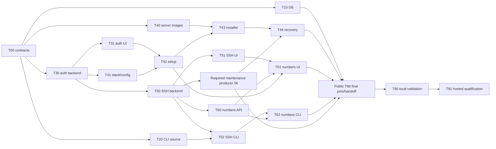

# Pre-v1 completion — execution plan

Status: Required public implementation is code complete: T00–T62 and source repairs #70–#75 are merged; public T80 #37 merged in #78 at `c2440df09653c9c23181322249f662fe1801de3a`. Its unpublished `0.0.1-rc.1` metadata pins actual dependency indexes, the current migration and CLI source `2a5ae0ccea6c3dd680b4146586ec0668c60c8b93`, without claiming tested runtime compatibility. Private T70 #36 is backlog outside scope. #44 and T90/T91 remain later unpassed validation, not code-completion prerequisites. No publication or release qualification. Date: 2026-11-12.
Entry point: [feature overview](1.pre-v1-release.md).

GitHub coordinator #19 records current claims, dependencies, exact merges and evidence gaps. The user authorized coordinator-managed implementation subagents in separate worktrees, commits, feature-branch pushes, PR creation and ordinary reviewed merges, and explicitly selected a code-only run without manual tests/builds or CI reruns. Existing automatic PR CI is not disabled or represented as a manual validation pass; final validation is a separate later session. That authorization does not permit private work, publication, deployment, hosted credentials, protection bypasses or takeover of retained unpublished work. Separate cross-account sessions remain supported; issue creation alone never dispatches them.

## Task index and hard dependencies

Each implementation row is one separately assignable issue/PR. “Contract” dependencies permit read-only scaffolding against a frozen interface; an implementation PR must build against merged prerequisites before it merges.

| ID | Task / spec | Issue | Hard dependencies before merge | Status |
| --- | --- | --- | --- | --- |
| T00 | [Shared contracts and ownership](subspecs/00-contracts.md) | #20 | None | Merged #40; `84ec9c3aea1ab2153333db1ddb457c44ca255df3` |
| T10 | [Remaining demonstrated DB/runtime defects](subspecs/10-database-completion.md) | #21 | T00 | Merged #41; `ad6d7dd375aaa89c4c2f282063899a27abbe1e6c`; hosted acceptance remains open |
| T20 | [Remove prebuilt CLI distribution](subspecs/20-cli-distribution.md) | #22 | T00 | Merged #42; `ac0c5f8871237ff290879bcac53743e867e6d8c6` |
| T30 | [Identity, sessions and shared bootstrap](subspecs/30-identity-and-sessions.md) | #23 | T00 | Foundation #43; browser-flow follow-up #46; complete shared bootstrap #52 merged `394ea088ab8fca4d6fb175c6fc5f824e319f5908`; producer #49 closed |
| T31 | [Dashboard authentication](subspecs/31-auth-dashboard.md) | #24 | T30 | Merged #46; `24e531464d148548f11691593041c809441526f2`; optional OIDC #67 and explicit packaged new-install opt-in #73 (`b123b9f2f80c6f4f3cae97b3fbdf32141d803014`), default disabled; dependent Compose contract #75 (`f952625c828ff4130a1c8d971a4c4e2d1d172b70`); live qualification remains #44 |
| T40 | [Server images and release bundle](subspecs/40-packaged-self-hosting.md#t40--images-and-release-assets) | #25 | T00, T20 contract | Merged #45; `fb9f717a473ee57b7b3deaf1fb8215b4f25509e1`; closed code complete; T80 input merged #78, actual release assets/publication remain deferred |
| T41 | [Dependency stack and runtime configuration](subspecs/40-packaged-self-hosting.md#t41--shared-stack-and-universal-dashboard) | #26 | T00, T30 contract | Code #47/#51/#53 plus target-agent architecture repair #72 (`04cba85212dfbcf0ae383893a6686e0f647c96fd`) merged; closed code complete; full-image/Kratos/combined/native acceptance retained in #38, #50 closed |
| T42 | [First operator and onboarding](subspecs/40-packaged-self-hosting.md#t42--first-operator-and-onboarding) | #27 | T30, T31, T41 | Code #54 merged `13f9bdb92316ba195b20180e967c1836ce700b1c`; route handoff complete; closed code complete, real-stack/proxy acceptance retained in #38 |
| T43 | [Installer and manual parity](subspecs/40-packaged-self-hosting.md#t43--installermanual-parity) | #28 | T40, T41, T42 | Code #55 merged `a42efe8cbdea1cc6c98194d27e41fb414f861807`; maintenance handoff complete; closed code complete, native/manual-parity acceptance retained in #38 |
| T44 | [Upgrade and coordinated recovery](subspecs/40-packaged-self-hosting.md#t44--upgrade-and-full-recovery) | #29 | T43, maintenance producer #56 | Code #57 plus interrupted-restore repair #74 (`03a2e8501c588ffa283766851646435d7395e153`) merged on producer repair #71 (`c3f523e7c16974ffc809f5ddde45f7291b8c3121`); closed code complete, full recovery/upgrade/transfer acceptance retained in #38 |
| T50 | [SSH backend/providers/worker](subspecs/50-ssh-provisioning.md#t50--backendprovidersworker) | #30 | T00, T30 | Merged #59 `80195715cb9d4cb55819e958a68098dd20ea9a4e`, #63 and duplicate-inventory/provenance repair #70 (`41a00fa25c400e8267716f3839419eb361b3d57d`); reopened source repair complete and issue closed |
| T51 | [SSH dashboard](subspecs/50-ssh-provisioning.md#t51--dashboard) | #31 | T50 | Merged #61 `900546e8f5cd94b305a0d4daae7acb3c514ca320` |
| T52 | [SSH CLI](subspecs/50-ssh-provisioning.md#t52--cli) | #32 | T50, T20 | Merged #60 `51d87f4201b5be1a2ae827da6d05ac22dae468e5` |
| T60 | [Deployment numbers: persistence/API](subspecs/60-deployment-numbers.md) | #33 | T00, T30, T50 | Merged #64 `2e3484bd274ac349b9a0612781a7b873efb96140`; number routes only (no legacy alias, per spec) |
| T61 | [Deployment numbers: dashboard](subspecs/60-deployment-numbers.md) | #34 | T60, T51, T42 route-file handoff after merge | Merged #66 `fef15c34699ef1f1d2e32297fc47e770c0859043` |
| T62 | [Deployment numbers: CLI](subspecs/60-deployment-numbers.md) | #35 | T60, T52 | Merged #65 `65d97d8c82a62583217b15a2521a58288c070f96` |
| T70 | [Private hosted integration](subspecs/70-hosted-operations.md) | #36 | Future private access/readiness handoff only; not a current public prerequisite | Backlog by explicit user direction; private work is neither performed nor required for public T80 |
| T80 | [Final source pins and candidate handoff](subspecs/80-candidate-handoff.md) | #37 | Required public T00–T62 implementation and source repairs merged | Merged #78 `c2440df09653c9c23181322249f662fe1801de3a`; public code complete only; [candidate identifiers and evidence limits](../../public-candidate-handoff.md) |
| T90 | [Codex local combined validation](subspecs/90-final-validation.md#t90--local-combined-integration) | #38 | T80 and all required public implementations merged | Public implementation prerequisites resolved; reserved validation deferred by user, not passed |
| T91 | [Codex hosted qualification](subspecs/90-final-validation.md#t91--controlled-hosteddisposable-host-qualification) | #39 | T90 passed; authorized candidate/assets and scoped operations access | Reserved for Codex |

T40/T41 may merge isolated build/configuration foundations after their contracts freeze; neither claims a complete install until the dependent implementations merge. If a foundation actually consumes unmerged runtime code, wait or split that consumption into its already listed dependent task, rather than merging a broken candidate.

The user explicitly requested resolution of the main blocker in the seven-blocked-issue chain. After actual source merges, #26 and already-implemented #27/#28 were closed as code complete, followed by repaired #29. Their unrun acceptance is retained in #38; no test result was converted to a pass. The user then reclassified #44 as later validation and T70 #36 as backlog outside public scope, explicitly removing their blocking relationships to #37. All other native dependencies and coordinator child links are retained. #25/#50 and merged follow-ups #48/#49/#56 are closed. Real images, Kratos, combined Compose, identical dashboard-image operation, proxy/TLS, native hosts and publication are not established by code-only closure.

Producer #56 merged in #62 after the T50 merge, then its lease-loss safety repair merged in #71: expired admitted activities remain uncertain and drain-blocking until recorded completion, including across restart/transfer. Orphans require evidence-based operator reconciliation, not forced expiry. T44 #74 queries actual authority and rechecks drain regardless of pending metadata. Offline recovery requires stopped local participants plus explicit external isolation/reconciliation. Recorded combined identity/application capture, lost-host restore, HTTPS-gated upgrade release and schedule limitations remain later acceptance work, not claimed failures or passes.

Automatic CI is separate evidence. Dashboard and release-contract checks passed on the reviewed feature PRs, but backend CI is not green: existing component-smoke raw deployment inserts omit the required deployment number, and one OIDC run reported SQLite fixture teardown exceptions. The new Google Compose-input expectation mismatch was corrected in #75. No manual tests/builds or CI reruns were performed, and neither unrelated failure was silently treated as resolved. Ordinary server-enforced merges used exact reviewed heads without bypass; backend CI was pending at the source merges.

## Launch waves and parallel lanes

| Wave | Assignments that can run together | Reason / merge handoff |
| --- | --- | --- |
| 0 | T00; read-only source discovery for later tasks | Resolve CLI policy and cross-feature contracts first. No competing shared schema edits. |
| 1 | T10 **parallel with** T20 **parallel with** T30 | DB/runtime, CLI delivery and auth backend have separate owners. Narrow T10 avoids shared schema unless explicitly handed off. |
| 2 | T31 **parallel with** T40 **parallel with** T41 **parallel with** T50 | After T30 merges/contracts freeze: ordinary auth UI, server distribution, installation/config and SSH backend. Handoff Dockerfiles/config rather than editing them concurrently. |
| 3 | T42 **parallel with** T51 **parallel with** T52 **parallel with** T60 | Setup screens, SSH UI, SSH CLI and numbered-deployment backend. Each must consume merged prerequisites and the exclusive file map. |
| 4 | T43 **parallel with** T61 **parallel with** T62 | Installer work and the two number-based clients. T61 waits for the T42 route-file handoff as well as T51/T60. |
| 5 | T44 after #56 | #56 first requires actual T50 merge/explicit narrow ownership handoff. Finish public backup/upgrade/recovery; private work is outside this run. |
| Backlog | T70 implementation/integration | Deferred by user; future private-repository authorization/readiness handoff only, not a public T80 blocker. |
| 7 | Public T80 | Align final public client source pins and candidate metadata after feature merges; no private dependency, publication or deployment. |
| 8 | T90, then T91 | Codex validates the combined merged candidate locally before controlled hosted tests. No parallel customer mutations. |

Waves are a convenient launch order, not extra dependencies: a ready task need not wait for unrelated work in its wave. No fixed agent count or new orchestration service is required.

The table is authoritative for all hard edges; the diagram summarizes the principal chains.

## Exclusive shared-file ownership

- **Backend models/DbContext/snapshot:** T30 → T50 → T60. Give each its own forward migration; rebase after predecessor merges. A separate read-only investigation is safe; two snapshot writers are not.
- **Deployment worker/runtime:** T10 owns implicated DB/agent/deployment files until merge, then T50 may change provisioning. Numbers retain opaque runtime IDs; T60 does not take over runtime mutation code.
- **Maintenance producer #56:** merged #62 after the T50 handoff; schema writers ran sequentially T30 → T50 → #56 → T60. T44 consumed the merged producer (#57). Further maintenance edits need a new claim through coordinator #19.
- **Dashboard auth:** T31 owns `AuthProvider`, session API integration and ordinary auth routes. T41 owns `runtimeConfig` and startup/config assets. T42 receives auth route ownership for setup only after T31; T61 receives shared routing files after T42.
- **Dashboard environment screens/shared models:** T51 → T61. T42 stays within setup/provider guidance and existing APIs; no concurrent provider/app screen rewrite.
- **CLI commands/models:** T20 distribution first; T52 SSH creation/update next; T62 deployment identity last. Auth T30 publishes CLI consent/session contracts but does not independently rewrite those command partials.
- **Public release files:** T20 owns existing CLI workflow/installers/customer workflow and CLI delivery docs. T40 owns a distinct server workflow/manifest. T41 owns Dockerfile/startup edits; T40 requests its handoff. T43 owns server installer/docs, followed by T44 maintenance/upgrade additions.
- **Private operations:** T70 only. Public agents never modify retained private product modules or depend on its unpushed changes.
- **Central tracker:** integration owner updates this plan from actual PR states. Agents update their assigned sub-spec/PR, avoiding competing edits to this index.

## Cross-account assignment and completion rules

### GitHub issue coordination

Umbrella issue #19 contains the task children and bounded follow-ups, including reserved validation gates. Each task issue links its public sub-spec, prerequisite issues, ownership/handoffs and acceptance. Preserve existing native blocked-by relationships. T40's T20 edge and T41's T30 edge are **contract** edges: record the frozen interface handoff and distinguish scaffolding from runtime integration; do not remove links merely because foundation code merged. Other hard edges require merged prerequisites (T10 may hand off a documented no-defect result).

Before editing, comment `Claim: <agent/session>; base: <SHA>; files: <exclusive paths>; prerequisites: <merged PR/SHAs or contract handoffs>` on the task issue. The first active claim owns those files; a second agent comments and waits rather than racing the owner. Post overlap requests on both affected issues and wait for an explicit handoff. Agents report progress/blockers and PR links on their own issue; only the integration owner reconciles this index and the umbrella checklist.

Handoff comments include released files, exact PR/merge SHA, contract changes, focused command/results and remaining evidence gaps. Keep issues open for unmerged work and retain incomplete required acceptance in explicit validation gates. In this user-authorized code-only pass, implementation issues may close after actual reviewed merges with their deferred acceptance explicitly handed to #38; #44/#38/#39 remain open qualification gates. A claim, green check or submitted PR is not a merge. No sessions are automatically launched by issue creation, and nobody is assigned without agreement.

T70's public issue is backlog, not a current dependency gate: future implementation/PR details stay in a separately authorized private issue, never public comments or attachments. T90/T91 are reserved for Codex and cannot be claimed as feature tasks. T00's frozen documentation is reachable through merged #40 at `84ec9c3aea1ab2153333db1ddb457c44ca255df3`; that old merge-pending blocker is resolved, not a waiver of later acceptance or exclusive-file gates.

Make these committed public specs reachable to the account the user uses for Copilot before starting its sessions. Public agents can use a fork/PR workflow; a repository maintainer approves any required fork workflow run. Never provide secrets or bypass protections to make fork CI pass. T70 requires explicit private-repository access and its own instructions; do not publish private content as a workaround.

For cross-account work, copy the assigned task's prompt into that account's issue/session with its ID, expected base/prerequisite PRs and exclusive files; the user controls that dispatch and merging. In the current explicitly authorized coordinator pass, #19 dispatches scoped subagents and performs ordinary reviewed merges. Neither mode grants release/deployment authority or permission to bypass protections.

Keep **not started**, **in progress**, **PR open**, **merged**, **blocked** and the separate validation results distinct. Record PR URL/merge SHA and focused checks before updating status. A no-defect result for a historical DB issue records the missing evidence and leaves its final hosted acceptance open. Do not relabel all old backlog entries as implementation tasks.
