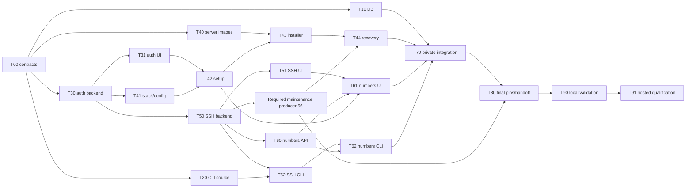

# Pre-v1 completion — execution plan

Status: Product code for T00–T62 and required follow-ups #48, #49, #56 and the #44 OIDC code is merged (latest `5ca99b9586ba1ac6b330af0db8c89958a9ec8068`). Acceptance gates #25–#29, #44 and #50 remain open for live validation; T70 private integration, T80 handoff and T90/T91 qualification remain. No publication or release qualification. Date: 2026-11-11.
Entry point: [feature overview](1.pre-v1-release.md).

GitHub coordinator #19 records current claims, dependencies, exact merges and evidence gaps. The user authorized coordinator-managed implementation subagents, feature-branch pushes and ordinary reviewed PR merges for this code-completion pass; final validation is a separate later session. That authorization does not permit publication, deployment, hosted credentials, protection bypasses or takeover of retained unpublished work. Separate cross-account sessions remain supported; issue creation alone never dispatches them.

## Task index and hard dependencies

Each implementation row is one separately assignable issue/PR. “Contract” dependencies permit read-only scaffolding against a frozen interface; an implementation PR must build against merged prerequisites before it merges.

| ID | Task / spec | Issue | Hard dependencies before merge | Status |
| --- | --- | --- | --- | --- |
| T00 | [Shared contracts and ownership](subspecs/00-contracts.md) | #20 | None | Merged #40; `84ec9c3aea1ab2153333db1ddb457c44ca255df3` |
| T10 | [Remaining demonstrated DB/runtime defects](subspecs/10-database-completion.md) | #21 | T00 | Merged #41; `ad6d7dd375aaa89c4c2f282063899a27abbe1e6c`; hosted acceptance remains open |
| T20 | [Remove prebuilt CLI distribution](subspecs/20-cli-distribution.md) | #22 | T00 | Merged #42; `ac0c5f8871237ff290879bcac53743e867e6d8c6` |
| T30 | [Identity, sessions and shared bootstrap](subspecs/30-identity-and-sessions.md) | #23 | T00 | Foundation #43; browser-flow follow-up #46; complete shared bootstrap #52 merged `394ea088ab8fca4d6fb175c6fc5f824e319f5908`; producer #49 closed |
| T31 | [Dashboard authentication](subspecs/31-auth-dashboard.md) | #24 | T30 | Merged #46; `24e531464d148548f11691593041c809441526f2`; optional Google OIDC code merged #67 `5ca99b9586ba1ac6b330af0db8c89958a9ec8068` (disabled by default); live Google/real-Kratos/separate-origin qualification remains #44 |
| T40 | [Server images and release bundle](subspecs/40-packaged-self-hosting.md#t40--images-and-release-assets) | #25 | T00, T20 contract | Merged #45; `fb9f717a473ee57b7b3deaf1fb8215b4f25509e1`; publication gates pending T41/T43/T44/T80 |
| T41 | [Dependency stack and runtime configuration](subspecs/40-packaged-self-hosting.md#t41--shared-stack-and-universal-dashboard) | #26 | T00, T30 contract | Code #47/#51/#53 merged; latest `f63b505f93700e9fc2eaf7b3486437ecc5155bab`; merged bootstrap packaged; full-image/Kratos/combined acceptance remains #50 |
| T42 | [First operator and onboarding](subspecs/40-packaged-self-hosting.md#t42--first-operator-and-onboarding) | #27 | T30, T31, T41 | Code #54 merged `13f9bdb92316ba195b20180e967c1836ce700b1c`; routes released to coordinator; real-stack/proxy acceptance remains open |
| T43 | [Installer and manual parity](subspecs/40-packaged-self-hosting.md#t43--installermanual-parity) | #28 | T40, T41, T42 | Code #55 merged `a42efe8cbdea1cc6c98194d27e41fb414f861807`; maintenance handed to T44; #50/host acceptance still gates completion |
| T44 | [Upgrade and coordinated recovery](subspecs/40-packaged-self-hosting.md#t44--upgrade-and-full-recovery) | #29 | T43, maintenance producer #56 | Code #57 merged `87b6bf8b6ba17b605c55db2027e288eb20cfbe73` on producer #56 (`1d8a6831288245153998490efd34ada817e1cc95`); coordinated fence/drain/backup/upgrade/restore/transfer; live backup/restore/lost-host acceptance and recorded gaps remain open in #29 |
| T50 | [SSH backend/providers/worker](subspecs/50-ssh-provisioning.md#t50--backendprovidersworker) | #30 | T00, T30 | Merged #59 `80195715cb9d4cb55819e958a68098dd20ea9a4e`; acceptance follow-up #48 merged #63 `e51408fe3b1b409484dd681f25b11f55ee1f97ec`; schema chain handed to #56/T60 |
| T51 | [SSH dashboard](subspecs/50-ssh-provisioning.md#t51--dashboard) | #31 | T50 | Merged #61 `900546e8f5cd94b305a0d4daae7acb3c514ca320` |
| T52 | [SSH CLI](subspecs/50-ssh-provisioning.md#t52--cli) | #32 | T50, T20 | Merged #60 `51d87f4201b5be1a2ae827da6d05ac22dae468e5` |
| T60 | [Deployment numbers: persistence/API](subspecs/60-deployment-numbers.md) | #33 | T00, T30, T50 | Merged #64 `2e3484bd274ac349b9a0612781a7b873efb96140`; number routes only (no legacy alias, per spec) |
| T61 | [Deployment numbers: dashboard](subspecs/60-deployment-numbers.md) | #34 | T60, T51, T42 route-file handoff after merge | Merged #66 `fef15c34699ef1f1d2e32297fc47e770c0859043` |
| T62 | [Deployment numbers: CLI](subspecs/60-deployment-numbers.md) | #35 | T60, T52 | Merged #65 `65d97d8c82a62583217b15a2521a58288c070f96` |
| T70 | [Private hosted integration](subspecs/70-hosted-operations.md) | #36 | T10 result, T20, T30–T62 required product tasks; private access/readiness handoff | Not started; existing readiness unpushed |
| T80 | [Final source pins and candidate handoff](subspecs/80-candidate-handoff.md) | #37 | All required T00–T70 and required follow-ups merged/accepted | Not started; open acceptance gates #25–#29, #44 and #50 remain visible |
| T90 | [Codex local combined validation](subspecs/90-final-validation.md#t90--local-combined-integration) | #38 | T80 and all required implementations merged | Reserved for Codex |
| T91 | [Codex hosted qualification](subspecs/90-final-validation.md#t91--controlled-hosteddisposable-host-qualification) | #39 | T90 passed; authorized candidate/assets and scoped operations access | Reserved for Codex |

T40/T41 may merge isolated build/configuration foundations after their contracts freeze; neither claims a complete install until the dependent implementations merge. If a foundation actually consumes unmerged runtime code, wait or split that consumption into its already listed dependent task, rather than merging a broken candidate.

The code-completion pass consumed actual merged code prerequisites while the user defers final combined validation. This does not close acceptance tasks: #50 still gates T41/T43 completion, and #25–#29, #44 and #50 remain visible to T80. #48 and #56 merged (#63, #62) and are closed. Real images, Kratos, combined Compose, identical dashboard-image operation, proxy/TLS, native hosts and publication are not established by focused synthetic checks or green PR CI.

Producer #56 merged in #62 (`1d8a6831288245153998490efd34ada817e1cc95`) after the T50 merge: durable installation-wide admission, drain status and epoch transfer, with the protected `maintenance` host command. T44 #57 consumed it and merged; its recorded gaps (separate minicloud/Kratos dumps, Kratos logins while fenced, lost-host restore, HTTPS-gated upgrade release, schedule re-authoring) remain #29 acceptance items.

## Launch waves and parallel lanes

| Wave | Assignments that can run together | Reason / merge handoff |
| --- | --- | --- |
| 0 | T00; read-only source discovery for later tasks | Resolve CLI policy and cross-feature contracts first. No competing shared schema edits. |
| 1 | T10 **parallel with** T20 **parallel with** T30 | DB/runtime, CLI delivery and auth backend have separate owners. Narrow T10 avoids shared schema unless explicitly handed off. |
| 2 | T31 **parallel with** T40 **parallel with** T41 **parallel with** T50 | After T30 merges/contracts freeze: ordinary auth UI, server distribution, installation/config and SSH backend. Handoff Dockerfiles/config rather than editing them concurrently. |
| 3 | T42 **parallel with** T51 **parallel with** T52 **parallel with** T60 | Setup screens, SSH UI, SSH CLI and numbered-deployment backend. Each must consume merged prerequisites and the exclusive file map. |
| 4 | T43 **parallel with** T61 **parallel with** T62 | Installer work and the two number-based clients. T61 waits for the T42 route-file handoff as well as T51/T60. |
| 5 | T44 after #56; T70 private preparation may overlap read-only | #56 first requires actual T50 merge/explicit narrow ownership handoff. Finish complete backup/upgrade/recovery; private final candidate wiring waits for final product contracts/commits. |
| 6 | T70 implementation/integration | Private-repository session only after authorized access and existing readiness handoff. |
| 7 | T80 | Align final client source pins and candidate metadata after feature merges; no publication/deployment. |
| 8 | T90, then T91 | Codex validates the combined merged candidate locally before controlled hosted tests. No parallel customer mutations. |

Waves are a convenient launch order, not extra dependencies: a ready task need not wait for unrelated work in its wave. No fixed agent count or new orchestration service is required.

The table is authoritative for all hard edges; the diagram summarizes the principal chains.

## Exclusive shared-file ownership

- **Backend models/DbContext/snapshot:** T30 → T50 → T60. Give each its own forward migration; rebase after predecessor merges. A separate read-only investigation is safe; two snapshot writers are not.
- **Deployment worker/runtime:** T10 owns implicated DB/agent/deployment files until merge, then T50 may change provisioning. Numbers retain opaque runtime IDs; T60 does not take over runtime mutation code.
- **Maintenance producer #56:** merged #62 after the T50 handoff; schema writers ran sequentially T30 → T50 → #56 → T60. T44 consumed the merged producer (#57). Further maintenance edits need a new claim through coordinator #19.
- **Dashboard auth:** T31 owns `AuthProvider`, session API integration and ordinary auth routes. T41 owns `runtimeConfig` and startup/config assets. T42 receives auth route ownership for setup only after T31; T61 receives shared routing files after T42.
- **Dashboard environment screens/shared models:** T51 → T61. T42 stays within setup/provider guidance and existing APIs; no concurrent provider/app screen rewrite.
- **CLI commands/models:** T20 distribution first; T52 SSH creation/update next; T62 deployment identity last. Auth T30 publishes CLI consent/session contracts but does not independently rewrite those command partials.
- **Public release files:** T20 owns existing CLI workflow/installers/customer workflow and CLI delivery docs. T40 owns a distinct server workflow/manifest. T41 owns Dockerfile/startup edits; T40 requests its handoff. T43 owns server installer/docs, followed by T44 maintenance/upgrade additions.
- **Private operations:** T70 only. Public agents never modify retained private product modules or depend on its unpushed changes.
- **Central tracker:** integration owner updates this plan from actual PR states. Agents update their assigned sub-spec/PR, avoiding competing edits to this index.

## Cross-account assignment and completion rules

### GitHub issue coordination

Umbrella issue #19 contains the task children and bounded follow-ups, including reserved validation gates. Each task issue links its public sub-spec, prerequisite issues, ownership/handoffs and acceptance. Preserve existing native blocked-by relationships. T40's T20 edge and T41's T30 edge are **contract** edges: record the frozen interface handoff and distinguish scaffolding from runtime integration; do not remove links merely because foundation code merged. Other hard edges require merged prerequisites (T10 may hand off a documented no-defect result).

Before editing, comment `Claim: <agent/session>; base: <SHA>; files: <exclusive paths>; prerequisites: <merged PR/SHAs or contract handoffs>` on the task issue. The first active claim owns those files; a second agent comments and waits rather than racing the owner. Post overlap requests on both affected issues and wait for an explicit handoff. Agents report progress/blockers and PR links on their own issue; only the integration owner reconciles this index and the umbrella checklist.

Handoff comments include released files, exact PR/merge SHA, contract changes, focused command/results and remaining evidence gaps. Keep issues open for unmerged work, including locally authored T50, and for incomplete required acceptance even after code merges. A claim, green check or submitted PR is not a merge. No sessions are automatically launched by issue creation, and nobody is assigned without agreement.

T70's public issue is an access/dependency gate only: implementation/PR details stay in an authorized private issue, never public comments or attachments. T90/T91 are reserved for Codex and cannot be claimed as feature tasks. T00's frozen documentation is reachable through merged #40 at `84ec9c3aea1ab2153333db1ddb457c44ca255df3`; that old merge-pending blocker is resolved, not a waiver of later implementation, acceptance or exclusive-file gates.

Make these committed public specs reachable to the account the user uses for Copilot before starting its sessions. Public agents can use a fork/PR workflow; a repository maintainer approves any required fork workflow run. Never provide secrets or bypass protections to make fork CI pass. T70 requires explicit private-repository access and its own instructions; do not publish private content as a workaround.

For cross-account work, copy the assigned task's prompt into that account's issue/session with its ID, expected base/prerequisite PRs and exclusive files; the user controls that dispatch and merging. In the current explicitly authorized coordinator pass, #19 dispatches scoped subagents and performs ordinary reviewed merges. Neither mode grants release/deployment authority or permission to bypass protections.

Keep **not started**, **in progress**, **PR open**, **merged**, **blocked** and the separate validation results distinct. Record PR URL/merge SHA and focused checks before updating status. A no-defect result for a historical DB issue records the missing evidence and leaves its final hosted acceptance open. Do not relabel all old backlog entries as implementation tasks.
