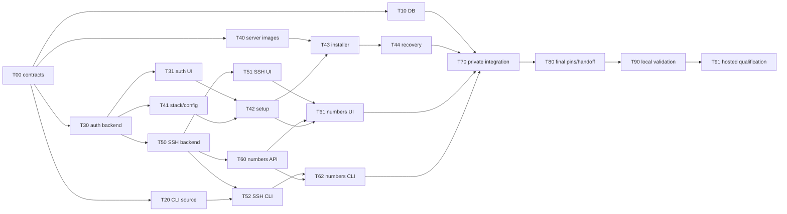

# Pre-v1 completion — execution plan

Status: T00 contract baseline authored; prerequisite merge pending. No downstream implementation sessions launched. Date: 2026-11-10.
Entry point: [feature overview](1.pre-v1-release.md).

The user launches separate GitHub Copilot sessions from another GitHub account. This plan assigns implementation; it does not dispatch sessions, releases or deployments. GitHub issues now coordinate task claims, dependencies and handoffs at the user's request. Codex performs final integration validation only after the required PRs merge.

## Task index and hard dependencies

Each implementation row is one separately assignable issue/PR. “Contract” dependencies permit read-only scaffolding against a frozen interface; an implementation PR must build against merged prerequisites before it merges.

| ID | Task / spec | Issue | Hard dependencies before merge | Status |
| --- | --- | --- | --- | --- |
| T00 | [Shared contracts and ownership](subspecs/00-contracts.md) | #20 | None | Contract baseline authored; merge pending |
| T10 | [Remaining demonstrated DB/runtime defects](subspecs/10-database-completion.md) | #21 | T00 | Not started; preserve PR #17 |
| T20 | [Remove prebuilt CLI distribution](subspecs/20-cli-distribution.md) | #22 | T00 | Partial: CLI release workflow removed; source-delivery migration pending |
| T30 | [Identity, sessions and shared bootstrap](subspecs/30-identity-and-sessions.md) | #23 | T00 | Not started |
| T31 | [Dashboard authentication](subspecs/31-auth-dashboard.md) | #24 | T30 | Not started |
| T40 | [Server images and release bundle](subspecs/40-packaged-self-hosting.md#t40--images-and-release-assets) | #25 | T00, T20 contract | Not started |
| T41 | [Dependency stack and runtime configuration](subspecs/40-packaged-self-hosting.md#t41--shared-stack-and-universal-dashboard) | #26 | T00, T30 contract | Not started |
| T42 | [First operator and onboarding](subspecs/40-packaged-self-hosting.md#t42--first-operator-and-onboarding) | #27 | T30, T31, T41 | Not started |
| T43 | [Installer and manual parity](subspecs/40-packaged-self-hosting.md#t43--installermanual-parity) | #28 | T40, T41, T42 | Not started |
| T44 | [Upgrade and coordinated recovery](subspecs/40-packaged-self-hosting.md#t44--upgrade-and-full-recovery) | #29 | T43 | Not started |
| T50 | [SSH backend/providers/worker](subspecs/50-ssh-provisioning.md#t50--backendprovidersworker) | #30 | T00, T30 | Not started |
| T51 | [SSH dashboard](subspecs/50-ssh-provisioning.md#t51--dashboard) | #31 | T50 | Not started |
| T52 | [SSH CLI](subspecs/50-ssh-provisioning.md#t52--cli) | #32 | T50, T20 | Not started |
| T60 | [Deployment numbers: persistence/API](subspecs/60-deployment-numbers.md) | #33 | T00, T30, T50 | Not started |
| T61 | [Deployment numbers: dashboard](subspecs/60-deployment-numbers.md) | #34 | T60, T51, T42 route-file handoff after merge | Not started |
| T62 | [Deployment numbers: CLI](subspecs/60-deployment-numbers.md) | #35 | T60, T52 | Not started |
| T70 | [Private hosted integration](subspecs/70-hosted-operations.md) | #36 | T10 result, T20, T30–T62 required product tasks; private access/readiness handoff | Not started; existing readiness unpushed |
| T80 | [Final source pins and candidate handoff](subspecs/80-candidate-handoff.md) | #37 | All required T00–T70 merged | Not started |
| T90 | [Codex local combined validation](subspecs/90-final-validation.md#t90--local-combined-integration) | #38 | T80 and all required implementations merged | Reserved for Codex |
| T91 | [Codex hosted qualification](subspecs/90-final-validation.md#t91--controlled-hosteddisposable-host-qualification) | #39 | T90 passed; authorized candidate/assets and scoped operations access | Reserved for Codex |

T40/T41 may merge isolated build/configuration foundations after their contracts freeze; neither claims a complete install until the dependent implementations merge. If a foundation actually consumes unmerged runtime code, wait or split that consumption into its already listed dependent task, rather than merging a broken candidate.

## Launch waves and parallel lanes

| Wave | Assignments that can run together | Reason / merge handoff |
| --- | --- | --- |
| 0 | T00; read-only source discovery for later tasks | Resolve CLI policy and cross-feature contracts first. No competing shared schema edits. |
| 1 | T10 **parallel with** T20 **parallel with** T30 | DB/runtime, CLI delivery and auth backend have separate owners. Narrow T10 avoids shared schema unless explicitly handed off. |
| 2 | T31 **parallel with** T40 **parallel with** T41 **parallel with** T50 | After T30 merges/contracts freeze: ordinary auth UI, server distribution, installation/config and SSH backend. Handoff Dockerfiles/config rather than editing them concurrently. |
| 3 | T42 **parallel with** T51 **parallel with** T52 **parallel with** T60 | Setup screens, SSH UI, SSH CLI and numbered-deployment backend. Each must consume merged prerequisites and the exclusive file map. |
| 4 | T43 **parallel with** T61 **parallel with** T62 | Installer work and the two number-based clients. T61 waits for the T42 route-file handoff as well as T51/T60. |
| 5 | T44; T70 private preparation may overlap read-only | Finish complete backup/upgrade/recovery; private final candidate wiring waits for final product contracts/commits. |
| 6 | T70 implementation/integration | Private-repository session only after authorized access and existing readiness handoff. |
| 7 | T80 | Align final client source pins and candidate metadata after feature merges; no publication/deployment. |
| 8 | T90, then T91 | Codex validates the combined merged candidate locally before controlled hosted tests. No parallel customer mutations. |

Waves are a convenient launch order, not extra dependencies: a ready task need not wait for unrelated work in its wave. No fixed agent count or new orchestration service is required.

The table is authoritative for all hard edges; the diagram summarizes the principal chains.

## Exclusive shared-file ownership

- **Backend models/DbContext/snapshot:** T30 → T50 → T60. Give each its own forward migration; rebase after predecessor merges. A separate read-only investigation is safe; two snapshot writers are not.
- **Deployment worker/runtime:** T10 owns implicated DB/agent/deployment files until merge, then T50 may change provisioning. Numbers retain opaque runtime IDs; T60 does not take over runtime mutation code.
- **Dashboard auth:** T31 owns `AuthProvider`, session API integration and ordinary auth routes. T41 owns `runtimeConfig` and startup/config assets. T42 receives auth route ownership for setup only after T31; T61 receives shared routing files after T42.
- **Dashboard environment screens/shared models:** T51 → T61. T42 stays within setup/provider guidance and existing APIs; no concurrent provider/app screen rewrite.
- **CLI commands/models:** T20 distribution first; T52 SSH creation/update next; T62 deployment identity last. Auth T30 publishes CLI consent/session contracts but does not independently rewrite those command partials.
- **Public release files:** T20 owns existing CLI workflow/installers/customer workflow and CLI delivery docs. T40 owns a distinct server workflow/manifest. T41 owns Dockerfile/startup edits; T40 requests its handoff. T43 owns server installer/docs, followed by T44 maintenance/upgrade additions.
- **Private operations:** T70 only. Public agents never modify retained private product modules or depend on its unpushed changes.
- **Central tracker:** integration owner updates this plan from actual PR states. Agents update their assigned sub-spec/PR, avoiding competing edits to this index.

## Cross-account assignment and completion rules

### GitHub issue coordination

Umbrella issue #19 contains one child issue for each table row, including reserved validation gates. Each task issue links its public sub-spec, prerequisite issues, ownership/handoffs and acceptance; GitHub blocked-by dependencies mirror the table. T40's T20 edge and T41's T30 edge are **contract** edges: the integration owner removes that blocker only after recording the frozen interface handoff, even if the producer implementation is still open. Other hard edges require merged prerequisites (T10 may hand off a documented no-defect result).

Before editing, comment `Claim: <agent/session>; base: <SHA>; files: <exclusive paths>; prerequisites: <merged PR/SHAs or contract handoffs>` on the task issue. The first active claim owns those files; a second agent comments and waits rather than racing the owner. Post overlap requests on both affected issues and wait for an explicit handoff. Agents report progress/blockers and PR links on their own issue; only the integration owner reconciles this index and the umbrella checklist.

Handoff comments include released files, exact PR/merge SHA, contract changes, focused command/results and remaining evidence gaps. Keep issues open for unmerged work, including locally authored T00. A claim, green check or submitted PR is not a merge. No sessions are automatically launched by issue creation, and nobody is assigned without agreement.

T70's public issue is an access/dependency gate only: implementation/PR details stay in an authorized private issue, never public comments or attachments. T90/T91 are reserved for Codex and cannot be claimed as feature tasks. Until this T00 documentation is reachable through a merged prerequisite PR, all downstream implementation remains blocked; existing main-branch specs alone are not the frozen handoff.

Make these committed public specs reachable to the account the user uses for Copilot before starting its sessions. Public agents can use a fork/PR workflow; a repository maintainer approves any required fork workflow run. Never provide secrets or bypass protections to make fork CI pass. T70 requires explicit private-repository access and its own instructions; do not publish private content as a workaround.

Copy the assigned task's prompt into that account's issue/session with its ID, expected base/prerequisite PRs and exclusive files. The user triggers the sessions and controls merging. Codex does not dispatch Copilot, open cross-account implementation sessions or start coding from this plan.

Keep **not started**, **in progress**, **PR open**, **merged**, **blocked** and the separate validation results distinct. Record PR URL/merge SHA and focused checks before updating status. A no-defect result for a historical DB issue records the missing evidence and leaves its final hosted acceptance open. Do not relabel all old backlog entries as implementation tasks.
